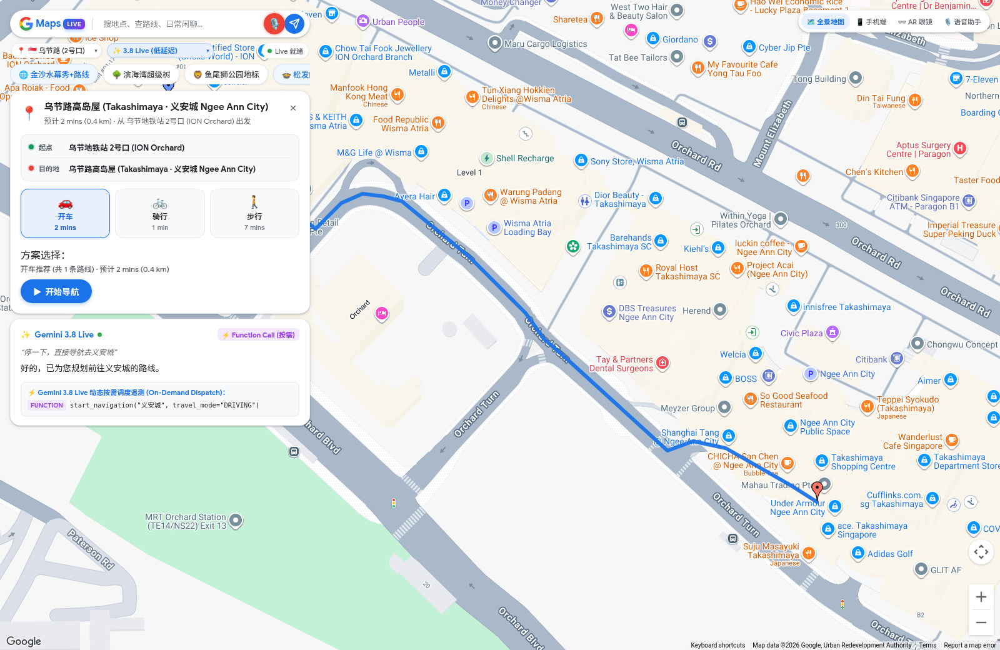
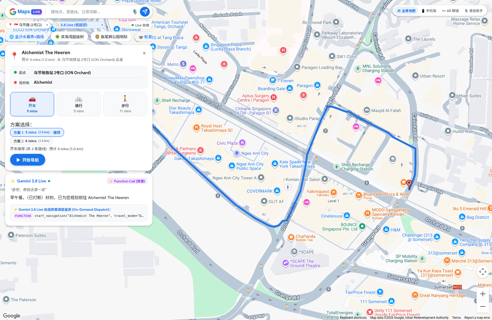
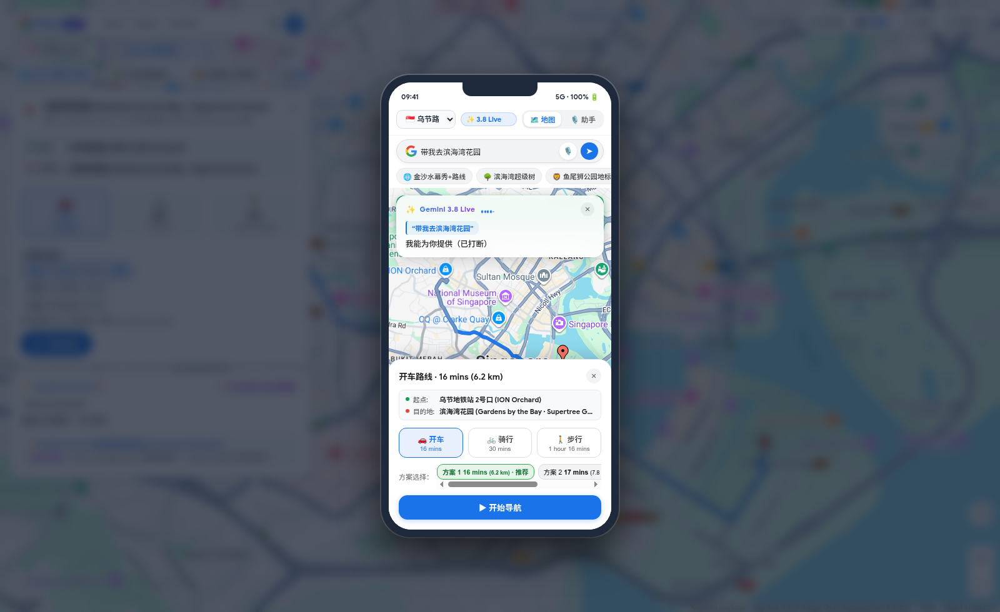
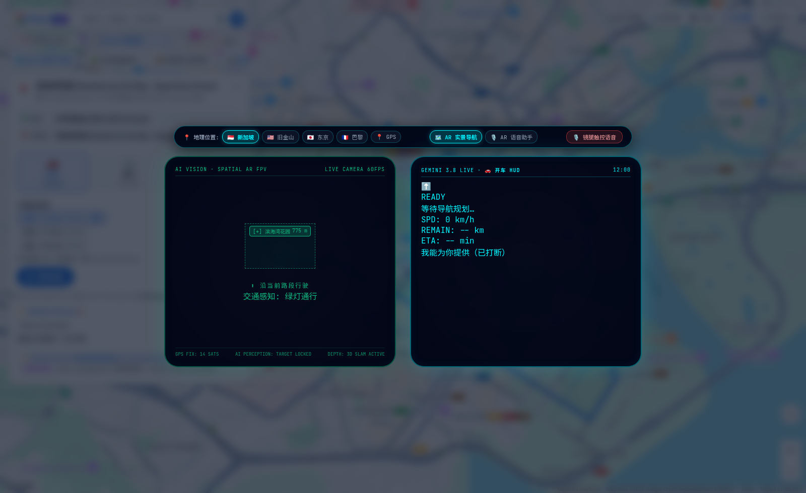
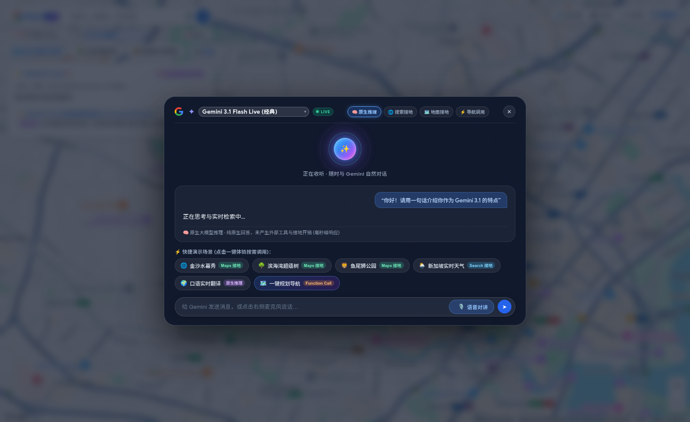
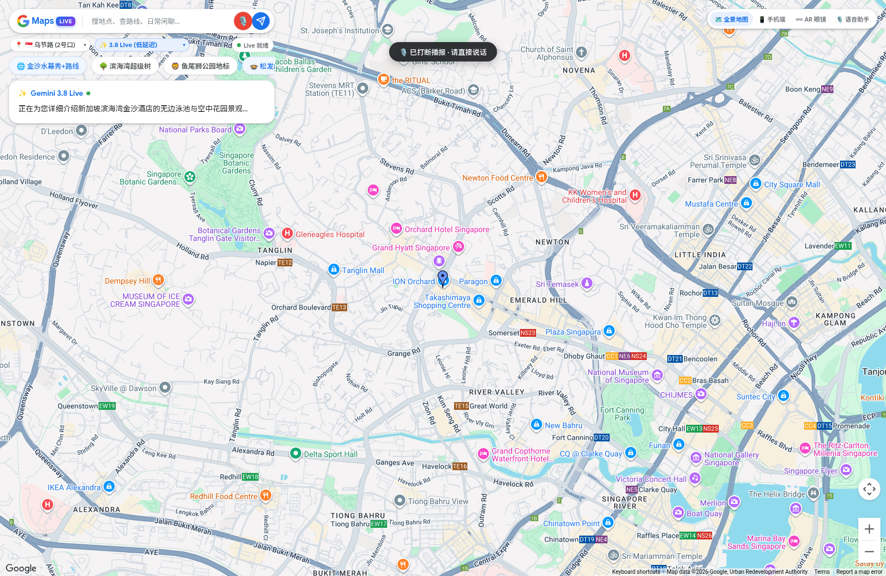
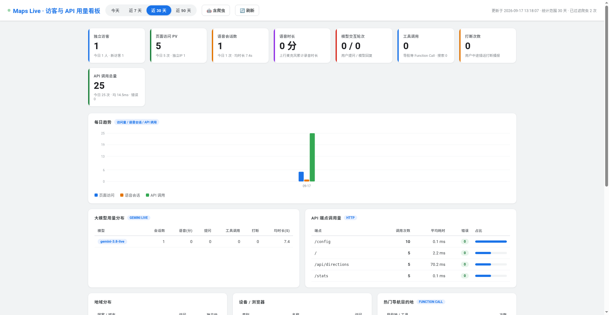

# Gemini Live API × Google Maps — Full-Duplex Voice Navigation Demo

一个基于 **Gemini Live API (`BidiGenerateContent` WebSocket)** 与 **Google Maps Platform** 构建的低延迟全双工实时语音导航与本地生活探索 Demo。

本工程演示了如何在**同一条毫秒级双向流式语音会话**中，同时结合：
1. **Google Maps Grounding（地图实时接地）** + **Google Search Grounding（实时联网检索）**
2. **Function Calling（按需工具调度）**：语音意图识别后自动触发 `start_navigation` 等导航与地图操作工具
3. **全双工语音打断（Full-Duplex Barge-in）**：支持模型播报途中随时开口插话打断、点击麦克风按键打断、WebRTC AEC 硬件回声消除与客户端 250ms 极速本地硬切
4. **四大终端形态实时预览**：支持 **🗺️ 全景地图（Panoramic Map）**、**📱 手机端（Mobile App）**、**👓 AR 智能眼镜（Smart Glasses HUD）** 与 **🎙️ 语音助手（Voice Assistant）** 四种交互视图一键切换
5. **零依赖访客与 API 用量看板（`/stats`）**：基于 SQLite WAL 的轻量级实时统计看板

---

## 📸 产品实机截图预览 (Product Screenshots)

### 1. 🗺️ 全景地图视图：全双工语音打断 + 按需触发 `start_navigation` 路线规划
> 用户在模型播报途中直接插话 *“停一下，直接导航去义安城”*，系统立即打断当前播报并触发 `start_navigation("义安城", travel_mode="DRIVING")`，在地图上绘制蓝色导航路线并展示开车/骑行/步行多方案耗时。



### 2. 🧠 多轮上下文指代消解导航（“走吧，带我去第一家”）
> 先让 Gemini 推荐周边门店，随后直接说 *“走吧，带我去第一家”*，模型自动根据上下文指代解析出目标门店（`Alchemist The Heeren`）并完成路线规划。



### 3. 📱 手机端视图 (Mobile App View) & 👓 AR 智能眼镜双目 HUD 视图 (Smart Glasses HUD)

| 📱 手机端地图导航视图 | 👓 AR 智能眼镜双目 HUD 视图 |
| :---: | :---: |
|  |  |
| 移动端仿真交互：支持顶部模型切换、实时语音浮窗、多方案路线抽屉与一键导航 | 双目 AR 眼镜投射：左眼空间视觉锚点与红绿灯感知，右眼实时车速/剩余距离/语音转写 HUD |

### 4. 🎙️ 沉浸式语音助手视图 & ⚡ 毫秒级播报打断体验

| 🎙️ 全屏语音助手视图 (Voice Assistant) | ⚡ 全双工实时打断提示 (`🎙️ 已打断播报 · 请直接说话`) |
| :---: | :---: |
|  |  |
| 支持原生推理 / 搜索接地 / 地图接地 / 导航调用四大能力开关与快捷场景芯片 | 模型长篇播报时点击麦克风或直接开口说话，0.25s 内清空本地音频缓冲并切换收音 |

### 5. 📊 访客记录与 API 用量实时监控看板 (`/stats`)
> 内置零外部前端依赖的 Google Cloud 风格统计看板，支持追踪独立访客（Cookie 去重）、页面 PV、语音会话数、录音时长、模型交互轮次、工具调用、打断次数与 HTTP API 端点耗时分布，自动过滤爬虫与扫描器噪音。



---

## 1. 系统架构

```text
Browser (index.html + app.js + duplex.js + AudioWorklet 16kHz PCM)
  │
  │  ws(s)://<your-host>/ws   (浏览器仅连接本服务，GEMINI_KEY 绝不暴露给前端)
  ▼
aiohttp Server (server/main.py)
  ├─ WebSocket 双向流式代理 (/ws)  ──► wss://generativelanguage.googleapis.com/...BidiGenerateContent
  ├─ 导航路线代理 (/api/directions) ──► Google Maps Directions REST API
  ├─ 客户端 IP 地理定位 (/api/geo)
  ├─ 前端 Maps JS 配置下发 (/config)
  └─ 访客与 API 统计看板 (/stats, /api/stats) ──► SQLite (server/logs/analytics.db)
```

### 核心安全设计
- **服务端密钥隔离**：`GEMINI_KEY` 仅保存在后端环境变量中，由 `server/main.py` 在服务端建立上游 WebSocket 双向透传通道，前端浏览器无法读取 Gemini API Key。
- **前端地图密钥按域名受限**：`MAPS_KEY` 供浏览器加载 Maps JavaScript SDK，建议在 Google Cloud Console 中配置 HTTP Referrer 白名单限制。

---

## 2. 功能特性

- **多模型动态切换**：
  - `models/gemini-3.8-live`（默认低延迟极速模式，`thinkingLevel: MINIMAL`）
  - `models/gemini-3.8-live`（深度思考模式，`thinkingLevel: LOW`）
  - `models/gemini-3.1-flash-live-preview`（经典低延迟模式）
- **四路全双工打断（Barge-in）**：
  - **开口语音打断**：支持服务端高灵敏度 VAD (`START_SENSITIVITY_HIGH`) + 客户端 `250ms` 本地音频硬切，模型正在长篇播报时开口说话即可瞬间静音并切换至新指令。
  - **麦克风按键打断**：模型播报期间点击麦克风按钮，立即清空待播音频队列并保持麦克风常开收音。
  - **文本与场景芯片打断**：随时输入文字或点击预置场景卡片（内置 6 段 16kHz 预录中文语音 PCM，无需麦克风亦可直接体验）。
- **多轮上下文与指代消解**：支持「推荐三家店」→「去第一家」→「改走路去」等自然多轮对话，内置会话续接（`sessionResumption`）与自动重连。
- **可观测性与统计看板**：
  - 结构化事件日志：`server/logger.py` + 命令行日志排查工具 `server/view_logs.py`
  - 实时 Web 看板：访问 `/stats` 查看独立访客（Cookie 去重）、页面 PV、语音会话数、录音时长、模型交互轮次、工具调用、打断次数与 API 端点耗时分布（自动识别并过滤爬虫与漏洞扫描探测）。

---

## 3. 快速开始（本地运行）

### 3.1 环境要求
- Python `3.10+`
- 一个有效的 **Gemini API Key**（Google AI Studio）
- 一个有效的 **Google Maps Platform API Key**，并在 Google Cloud Console 中启用以下 API：
  - `Maps JavaScript API`
  - `Places API (New)` 与 `Places API`
  - `Directions API`
  - `Geocoding API`

### 3.2 安装依赖与启动服务

```bash
# 1. 创建并激活虚拟环境
python3 -m venv venv
source venv/bin/activate

# 2. 安装依赖
pip install -r requirements.txt

# 3. 配置环境变量（请替换为您的真实 API Key）
export GEMINI_KEY="your_gemini_api_key_here"
export MAPS_KEY="your_google_maps_api_key_here"
export PORT=8080

# （可选）为 /stats 统计看板设置访问口令保护
# export STATS_TOKEN="your_custom_secret_token"

# 4. 启动服务
python3 server/main.py
```

启动后在浏览器打开：
- **主应用**：`http://localhost:8080/`
- **统计看板**：`http://localhost:8080/stats`（若配置了 `STATS_TOKEN`，请访问 `http://localhost:8080/stats?token=your_custom_secret_token`）
- **健康检查**：`http://localhost:8080/healthz`

---

## 4. Docker 容器化运行

```bash
docker build -t maps-live-demo .

docker run -d --name maps-live \
  -p 8080:8080 \
  -e GEMINI_KEY="your_gemini_api_key_here" \
  -e MAPS_KEY="your_google_maps_api_key_here" \
  maps-live-demo
```

---

## 5. 目录结构

```text
.
├── Dockerfile                         # 容器化构建文件
├── README.md                          # 项目说明与部署文档（含实机截图预览）
├── requirements.txt                   # Python 依赖声明 (aiohttp)
├── .env.example                       # 环境变量配置模板（不含任何真实密钥）
├── gen_audio.py                       # 预置场景 16kHz PCM 语音生成脚本 (Cloud TTS)
├── docs/
│   └── screenshots/                   # 多端产品实机截图 (全景地图/移动端/AR眼镜/语音助手/监控看板)
└── server/
    ├── main.py                        # aiohttp 后端：WS 代理、Directions 代理、静态托管
    ├── analytics.py                   # SQLite 访客记录与 API 调用统计引擎
    ├── logger.py                      # 结构化文本与 JSONL 双写日志模块
    ├── view_logs.py                   # 终端彩色日志实时查看与过滤 CLI 工具
    ├── static/
    │   ├── index.html                 # 主页面（四端视图切换：全景地图/手机端/AR眼镜/语音助手）
    │   ├── app.js                     # 核心前端逻辑（Live WS 协议、Maps SDK 渲染、工具调度）
    │   ├── duplex.js                  # 全双工语音引擎（AEC 回环、能量门限、250ms 本地硬切）
    │   ├── pcm-capture-worklet.js     # WebAudio AudioWorklet 16kHz PCM 采集处理器
    │   ├── style.css                  # 响应式与玻璃拟态样式表
    │   ├── stats.html                 # 零依赖访客与 API 用量监控看板页面
    │   └── audio/                     # 预录场景音频 (s1.pcm ~ s6.pcm, 16kHz Int16 LE)
    └── tests/
        ├── analytics_test.py          # 统计引擎单元测试 (55 项断言)
        ├── duplex_test.js             # 全双工语音与打断状态机单元测试 (156 项断言)
        ├── rec_options_test.js        # 门店推荐卡片解析单元测试 (48 项断言)
        ├── smart_nav_test.js          # 智能导航与指代消解单元测试 (16 项断言)
        └── voice_scope_test.js        # 多视图语音作用域隔离单元测试 (54 项断言)
```

---

## 6. 运行自动化单元测试

本工程包含 **329 项**无外部密钥依赖的本地单元测试（Python + Node.js）：

```bash
# 运行后端统计模块单元测试 (55 项断言)
python3 server/tests/analytics_test.py

# 运行前端全双工语音、导航与多端视图单元测试 (274 项断言，需 Node.js 18+)
node server/tests/duplex_test.js
node server/tests/rec_options_test.js
node server/tests/smart_nav_test.js
node server/tests/voice_scope_test.js
```
